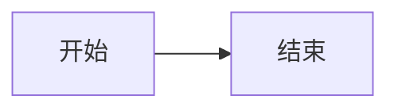
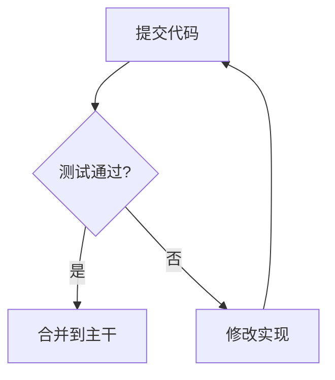
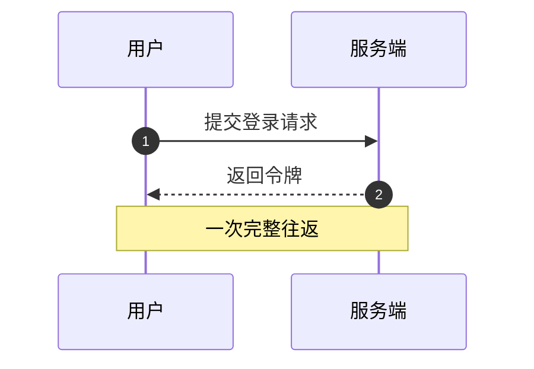
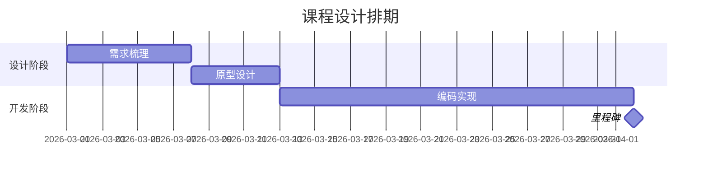
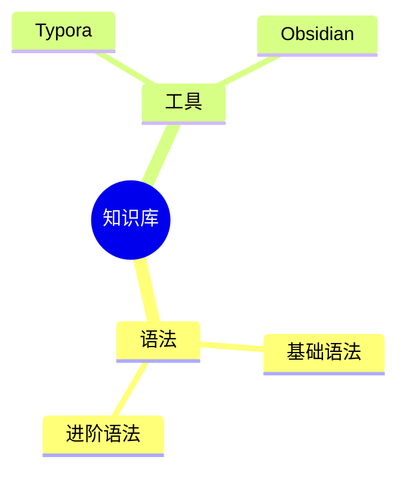

# Mermaid 图表：在 Markdown 里画流程图

把 Mermaid 语法放进语言标识为 `mermaid` 的代码围栏里，支持它的渲染器会直接画出流程图、时序图或甘特图；不支持的环境只会显示一段源码。图表由文本生成，可以随文档一起进版本库，改一行文字就能更新整张图，这是它相对截图的最大优势。

## 一、基本用法

一个最小可用的例子：

````markdown

````

三条硬性要求：语言标识必须小写写成 `mermaid`；图表类型关键字拼写正确，如 `flowchart`、`sequenceDiagram`；缩进统一用空格，四个空格或两个空格都行，但必须一致，混用 Tab 是最常见的报错原因。如果最终要导出 PDF 或发到公众号，先在本机渲染好再截图，别指望目标平台会解析源码。

## 二、flowchart：节点、箭头与判断分支



各部分的写法：

- 方向：`TD` 或 `TB` 从上到下，`LR` 从左到右，`RL`、`BT` 是反向。
- 节点：`A[矩形]`、`A(圆角矩形)`、`A{菱形判断}`、`A((圆形))`、`A[(数据库)]`。
- 箭头：`-->` 实线箭头、`---` 无箭头连线、`-.->` 虚线、`==>` 粗线。
- 连线文字：`A -- 是 --> B` 或 `A -->|是| B`，两种写法等价。
- 分组：用 `subgraph 名称` 与 `end` 包住一组节点，表示同一系统或同一阶段。

节点编号只是引用名，不会显示在图上，显示的是方括号里的文字。

## 三、sequenceDiagram：参与者与消息



`participant 别名 as 显示名` 声明参与者，声明顺序决定左右排列。消息箭头分三种：`->>` 实线箭头表示请求，`-->>` 虚线箭头表示返回，`-x` 带叉表示失败或中断。用 `loop 条件` 与 `end` 表示循环，用 `alt 情况一`、`else 情况二`、`end` 表示分支。参与者超过六七个时横向会挤，考虑拆图。

## 四、gantt 与 mindmap

甘特图用日期和时长描述排期：

````markdown

````

`dateFormat` 声明日期格式，`section` 划分阶段，任务行格式是「名称 :编号, 开始时间, 时长」。开始时间可以直接写日期，也可以用 `after 编号` 依赖前序任务；`milestone` 画成里程碑菱形。

思维导图用缩进表示层级：

````markdown

````

`root((文字))` 是中心节点，往下一层多缩进一级。mindmap 是比较新的图表类型，需要 Mermaid 9.3 以上版本，旧渲染器会直接报错。

## 五、平台支持与渲染失败排查

| 平台 | 原生支持 | 说明 |
| --- | --- | --- |
| GitHub | 是 | 仓库文件、Issue、评论都会渲染 |
| GitLab | 是 | 自托管实例需确认已启用 |
| Obsidian | 是 | 内置，离线可用 |
| Typora | 是 | 新版内置，导出依赖 Mermaid 版本 |
| VS Code 预览 | 否 | 需安装 Mermaid 预览扩展 |
| Hugo、Jekyll | 否 | 需插件或渲染钩子注入脚本 |
| 飞书文档、Notion | 否 | 多数版本需贴图或用自带图表 |
| 微信公众号 | 否 | 只能贴渲染后的图片 |

渲染失败常见的六类原因：

- 缩进混用 Tab 和空格，或同一层级缩进宽度不一致。
- 节点文字里有中文引号、全角括号，解析器把它当语法符号。
- 节点文字含圆括号、方括号、竖线、分号，必须整体加英文双引号，写成 `A["文本（说明）"]`。
- 把节点的编号起成 `end`，与结束关键字冲突，改名为 `End` 或加引号。
- 用了当前版本不存在的语法，例如旧版里的 mindmap、timeline。
- 围栏语言标识写错，图表被当成普通代码原样显示。

排查顺序是先删到只剩两个节点，确认能渲染，再逐步加回内容，问题通常出在某个节点的文字上。

## 六、图表该画到什么粒度

一张图只回答一个问题。流程图的节点控制在五到九个，超过十五个就拆成主流程加子流程；判断分支的每条线都要写条件，不能只画箭头不写文字；节点用动词短语，如「校验参数」，不用「参数校验模块」这种名词堆叠。时序图只画关键调用，把日志里的每一步都画上，读者反而抓不住重点。甘特图只放阶段和里程碑，细化到每个人的每日任务，维护成本会超过收益。

图表和正文要有分工：正文说清逻辑，图表只做结构提示。如果图里的信息正文完全没提，读者会跳过图；如果正文已经讲完，图就是重复。还要把维护成本算进去：需求一变就要改图，文本图的修改成本低于重画，但节点堆到几十个时，源码本身也会难以阅读，那时该拆图而不是继续加行。

## 速查

- 用 ` ```mermaid ` 围栏，语言标识必须写对。
- 流程图方向 `TD` 上下、`LR` 左右，判断用 `{}`。
- 节点文字含特殊符号时整体加英文双引号。
- 时序图消息 `->>` 请求、`-->>` 返回。
- 甘特图任务格式为名称、编号、开始、时长四段。
- 思维导图靠缩进分层，需要较新版本。
- 缩进混用 Tab 与空格是头号报错原因。
- 一张图回答一个问题，节点控制在九个以内。
